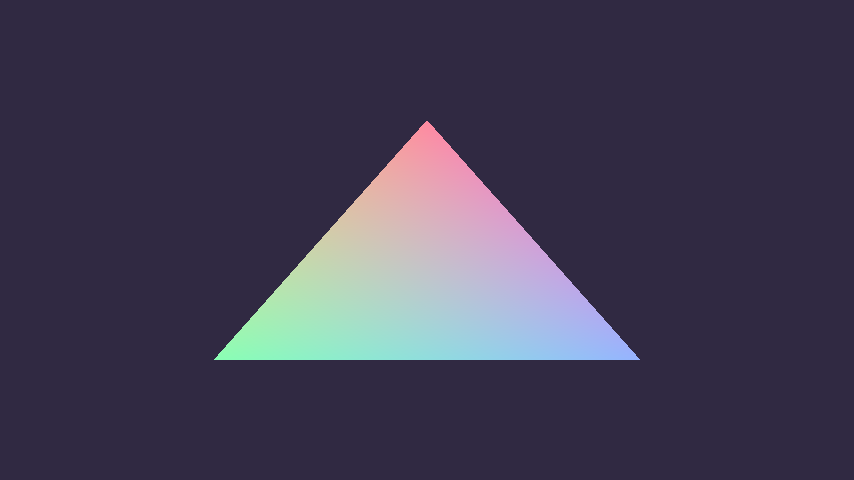
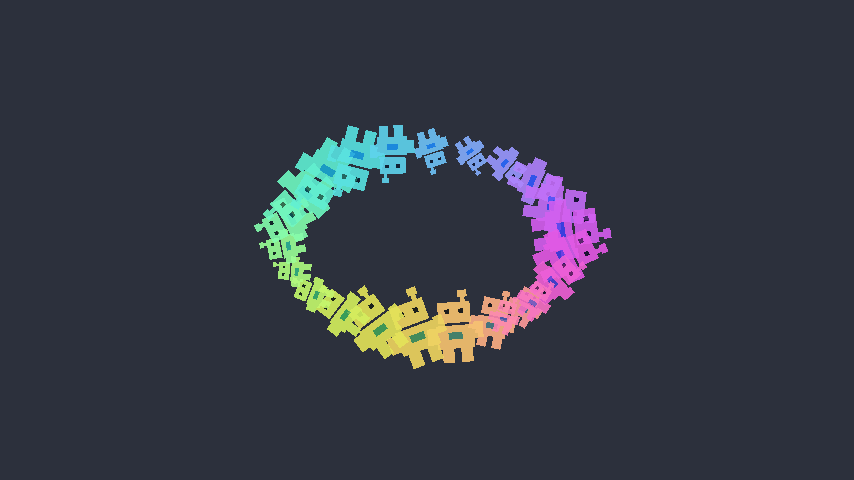
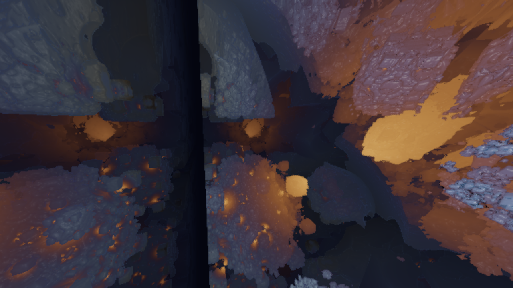

# chad

A thin platform layer for games and apps on **winit + wgpu**. Not an engine.

**Desktop · WebGPU · Android (Java UI Looper + Vulkan)**

> **Re-exports winit `0.30` + wgpu `30`** as `chad::winit` / `chad::wgpu` — write against those, don't add your own. See [Versioning](#versioning).

chad owns the part of every winit+wgpu project that is ugly, subtle, and
identical across projects — the event loop, window creation, GPU init
(including the async dance the browser forces), surface lifecycle, and frame
timing — and hands you raw `winit` events and raw `wgpu` types. No wrappers,
no ECS, no scenes, no assets. You implement one trait; everything else is
your code.

Windows desktop and headless contexts default to DX12. Set `WGPU_BACKEND` to
explicitly select another backend. Android remains Vulkan-only, and Web is
unchanged.

```rust
use chad::{wgpu, ChadApp, Config, Ctx};
use chad::winit::event::WindowEvent;

struct Game;

impl ChadApp for Game {
    fn init(ctx: &mut Ctx) -> Result<Self, String> {
        // ctx.device / ctx.queue / ctx.surface_format: build your pipelines here
        Ok(Game)
    }
    fn event(&mut self, ctx: &mut Ctx, event: &WindowEvent) {
        if let WindowEvent::CloseRequested = event {
            ctx.exit(); // chad never exits on its own
        }
    }
    fn update(&mut self, ctx: &mut Ctx) {
        // simulation tick; ctx.dt per the configured timestep
    }
    fn frame(&mut self, ctx: &mut Ctx, view: &wgpu::TextureView) {
        // record and submit whatever passes you like into `view`
    }
}

fn main() {
    chad::run::<Game>(Config::default()).unwrap();
}
```

## Examples

Run an example with `cargo run --example <name>`. Click a preview to run its Web build:

| # | preview | example / focus |
|---:|---|---|
| 1 | [](https://xpjb.github.io/chad/triangle/) | [`triangle`](examples/triangle.rs) · [Web](https://xpjb.github.io/chad/triangle/)<br>Smallest complete app |
| 2 | [](https://xpjb.github.io/chad/halfpipe/) | [`halfpipe`](examples/halfpipe.rs) · [Web](https://xpjb.github.io/chad/halfpipe/)<br>Fixed 20 Hz updates and render interpolation; Space toggles smoothing |
| 3 | [](https://xpjb.github.io/chad/clock/) | [`clock`](examples/clock.rs) · [Web](https://xpjb.github.io/chad/clock/)<br>On-demand redraw with `Waker`, plus a procedural window icon |
| 4 | [](https://xpjb.github.io/chad/sprite_batch/) | [`sprite_batch`](examples/sprite_batch.rs) · [Web](https://xpjb.github.io/chad/sprite_batch/)<br>Generated character texture, dynamic instances, alpha blending, one draw |
| 5 | [](https://xpjb.github.io/chad/fractal_flight/) | [`fractal_flight`](examples/fractal_flight.rs) · [Web](https://xpjb.github.io/chad/fractal_flight/)<br>Advanced Mandelbox raymarching showcase with flight controls and collision |

## Headless rendering

On native targets, `HeadlessCtx` owns a wgpu device and one RGBA8 sRGB
offscreen target. Both `Ctx` and `HeadlessCtx` implement `RenderContext`, so
window-independent setup and drawing can use the same renderer:

```rust
fn draw(ctx: &impl chad::RenderContext, view: &chad::wgpu::TextureView) {
    // Build/encode/submit raw wgpu work through ctx.device() and ctx.queue().
}

let config = chad::Config {
    size: (1280, 720),
    ..Default::default()
};
let ctx = chad::HeadlessCtx::new(&config)?;
draw(&ctx, ctx.view());
let rgba = ctx.read_rgba8()?;
```

The readback is tightly packed, top-to-bottom RGBA8; image encoding remains
consumer-owned. The examples add a local `--screenshot <path>` path using this
same rendering code. Regenerate every committed example preview with
`scripts/update-gallery.ps1` on Windows or `scripts/update-gallery.sh` on Unix.

## Android

This experimental branch uses the current-git `winit-android-support` fork and a regular Java
`Activity`. Android's UI Looper owns dispatch; Rust receives bounded JNI callbacks instead of
running a `NativeActivity` worker-thread event loop.

Implement `chad::android::App` and export the bridge once from the Android `cdylib`:

```rust,ignore
chad::android_activity_entry!(MyApp, chad::android::Config::default());
```

Package the three Java sources under `android/java/org/rustwindowing/winit` and name
`org.rustwindowing.winit.WinitActivity` in the manifest. The Java Activity owns lifecycle, a
`SurfaceView`, Choreographer scheduling, Back dispatch, pointer history/timestamps, keyboard
dispatch, insets, and a real `InputConnection`.

Text input no longer uses a transparent `EditText`, a bounded Java mirror, per-edit generations, or
per-frame surrounding-text copies. `Ctx::set_text_input` configures focus and IME options; Android
then synchronously calls `App::text_input_request` to read or mutate the application's real document.
Text-service coordinates are UTF-16 code units, matching Android and Ropey's UTF-16 conversion APIs.
A session ID rejects obsolete `InputConnection` instances.

- `init` runs after the first Android Surface and GPU are ready.
- `resumed` follows init and each surface recreation.
- `suspended` runs after the WGPU surface is dropped and before Java releases its Surface.
- Updates, rendering, input, and text callbacks are serialized on the Java UI thread. They must stay
  short; persistence and other blocking work belong on background workers.
- Window/platform operations are queued by Rust and applied only after the originating JNI callback
  returns, preventing same-thread nested mutable reentry.
- Presentation defaults to `AutoVsync` with a one-frame latency hint.

This path is intentionally experimental. Native context menus, selection haptics, task-backgrounding,
and full IME cursor geometry are still being wired.

## What you get

- Window + full wgpu init, blocking on native, async on wasm (browsers forbid
  blocking the main thread; chad runs init as a future and calls your `init`
  when the GPU is ready)
- Surface lifecycle: resize, surface-lost recovery, minimize handling, sRGB
  view formats where the surface is non-sRGB (WebGPU), show-after-first-frame
  (no white flash)
- A native `HeadlessCtx` implementing the same `RenderContext` as `Ctx`, with an owned offscreen target and RGBA8 readback
- Frame timing: variable dt or a fix-your-timestep accumulator
  (`Timestep::Fixed`) with interpolation alpha and a death-spiral clamp; dt is
  clamped so debugger pauses don't launch your player through a wall
- Vsync as a `Config` bool with a runtime toggle (`ctx.set_vsync`), or an
  exact `wgpu::PresentMode` if you know what you want
- `DeviceEvent` forwarding (raw mouse deltas — what a mouselook camera needs)
- Continuous or on-demand redraw, optional hybrid sleep/spin frame cap
- A payloadless `Waker` to nudge the loop from other threads (drain your own
  channels in `update`)
- Logging and panic reporting are installed by default: native panics also
  write `crash.log`; Web logs and panics go to the browser console
- `Config` exposes `wgpu` device features and limits, so needing push
  constants doesn't mean forking the runner

## What you don't get (on purpose)

The scope rule: something belongs in chad only if implementing it correctly
requires touching the event loop, window, or surface lifecycle — or is
literally identical in every game. Everything else is your code: input
mapping, audio, assets, networking, ECS, scenes, UI. If chad ever needs to
know what a "game object" is, that's a bug.

## Web

Desktop and Web use the same `ChadApp`. Keep it in `src/lib.rs`, expose one
shared `run`, and add the small browser entry point below.

```toml
# Cargo.toml
[lib]
crate-type = ["cdylib", "rlib"]

[target.'cfg(target_arch = "wasm32")'.dependencies]
wasm-bindgen = "0.2"
```

```rust
pub fn run() -> Result<(), String> {
    chad::run::<Game>(Config::default())
}

#[cfg(target_arch = "wasm32")]
#[wasm_bindgen::prelude::wasm_bindgen(start)]
pub fn wasm_start() {
    run().unwrap();
}
```

The native `src/main.rs` can call the same function:

```rust
fn main() -> Result<(), String> {
    your_crate::run()
}
```

Install the target and `wasm-bindgen` CLI, then build the library and generate
the browser module. The CLI version must match the `wasm-bindgen` version in
`Cargo.lock`.

```sh
rustup target add wasm32-unknown-unknown
cargo install wasm-bindgen-cli --version 0.2.126 --locked
cargo build --lib --target wasm32-unknown-unknown
wasm-bindgen --target web --out-dir web/pkg target/wasm32-unknown-unknown/debug/your_crate.wasm
```

Use a minimal `web/index.html`:

```html
<!doctype html>
<meta charset="utf-8">
<meta name="viewport" content="width=device-width, initial-scale=1">
<title>My game</title>
<style>
  html, body { margin: 0; width: 100%; height: 100%; overflow: hidden; background: #000; color: #fff; }
  canvas { display: block; }
</style>
<body>
  <script type="module">
    import init from "./pkg/your_crate.js";
    if (!navigator.gpu) {
      document.body.textContent = "This game requires WebGPU.";
    } else {
      init().catch((error) => console.error(error));
    }
  </script>
</body>
```

Serve it over HTTP—for example,
`python -m http.server 8080 --directory web`—and open
`http://localhost:8080`. chad appends its canvas to `<body>` and keeps it at
the body's size; `Config.size` is only the initial backing size. WebGPU/game
initialization continues asynchronously after the module loads. After the
first frame is presented, chad dispatches a `chad-ready` event on `window`;
loading screens can wait for it. Fatal startup errors and panics are reported
to the browser console. WebGPU only; there is no WebGL fallback.

## Versioning

Because `winit` and `wgpu` are re-exported, their major versions are part of
chad's public API: a release that bumps either is a breaking release of chad.
Currently winit 0.30, wgpu 30 (for winit, `0.30` *is* the major under pre-1.0
semver). Reach them through `chad::winit` / `chad::wgpu`, never your own dep.

## License

Licensed under either of [Apache License, Version 2.0](LICENSE-APACHE) or
[MIT license](LICENSE-MIT) at your option.
